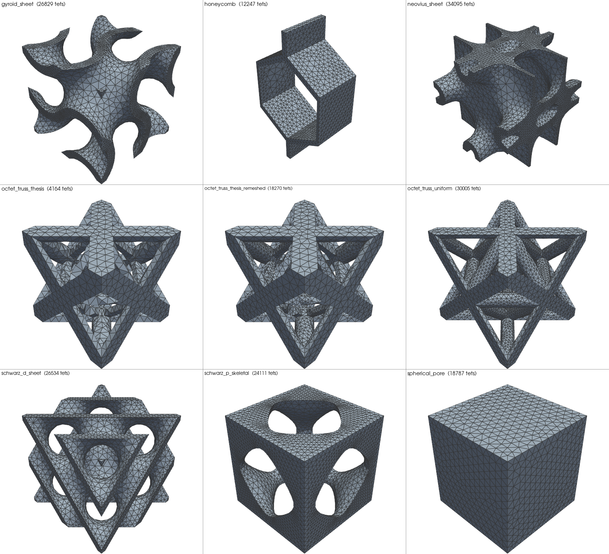

# Example RVE meshes

Ready-to-use periodic RVE meshes for the database generation, built with
[microgen](https://github.com/3MAH/microgen) 1.3.1 following the workflow of its
[examples](https://3mah.github.io/microgen-docs/examples/index.html) ("Periodic gyroid mesh from
a STEP file", "Periodic remeshing"):

1. geometry with microgen (CAD solid, or voxel grid for one TPMS);
2. periodic tetrahedral mesh with gmsh (`microgen.meshPeriodic`);
3. **remeshing with mmg keeping periodicity** (`microgen.remesh.remesh_keeping_periodicity_for_fem`;
   `remesh_keeping_boundaries_for_fem(..., periodic=True)` in microgen 2): the triangles on the cell
   faces are frozen and the rest is remeshed, which removes the slivers gmsh leaves along the
   tessellated surfaces of TPMS and curved struts;
4. gmsh format 2.2 file, read by fedoo.

Each mesh is a box-shaped periodic cell of one material, in linear tetrahedra, and passes
`scripts/check_rve.py`. To use one, set in `../configs/database.yaml`:

```yaml
geometry:
  mesh_file: rve_examples/gyroid_sheet.msh
```

## The examples



| Mesh | Geometry | microgen example | Cell | Solid fraction | nodes / tet4 | C11 | C12 | C44 | EPICP, 10 increments |
|------|----------|------------------|------|---------------:|-------------:|----:|----:|----:|---------------------:|
| `octet_truss_thesis.msh` | Octet truss of the thesis, face struts r = 0.10, inner r = 0.05, **gmsh only** (default) | `Lattices/octet_truss` | 1 x 1 x 1 | 0.228 | 1728 / 4164 | 8643 | 3683 | 3580 | 1.9 s |
| `octet_truss_thesis_remeshed.msh` | Same geometry, remeshed with mmg | `Lattices/octet_truss`, `Mesh/remesh` | 1 x 1 x 1 | 0.231 | 5192 / 18270 | 8466 | 3704 | 3418 | 7.6 s |
| `octet_truss_uniform.msh` | Octet truss, all struts r = 0.07 | `Lattices/octet_truss` | 1 x 1 x 1 | 0.197 | 8286 / 30005 | 6543 | 3135 | 2931 | 13.0 s |
| `gyroid_sheet.msh` | Gyroid TPMS sheet | `Mesh/periodic_gyroid_remesh` | 1 x 1 x 1 | 0.251 | 7617 / 26829 | 16174 | 7569 | 4952 | 16.5 s |
| `neovius_sheet.msh` | Neovius TPMS sheet | `TPMS/tpms_surfaces` | 1 x 1 x 1 | 0.251 | 8871 / 34095 | 17481 | 2743 | 1279 | 22.1 s |
| `schwarz_p_skeletal.msh` | Schwarz P TPMS, skeletal (lower) solid | `TPMS/tpms_surfaces` | 1 x 1 x 1 | 0.299 | 6469 / 24111 | 14557 | 1588 | 2386 | 23.2 s |
| `schwarz_d_sheet.msh` | Schwarz D (diamond) TPMS sheet, voxel route | `Mesh/remesh` | 1 x 1 x 1 | 0.251 | 7549 / 26534 | 17708 | 7070 | 4683 | 16.4 s |
| `spherical_pore.msh` | Cube with a centred spherical pore, r = 0.4 | `BasicShapes/shapes` | 1 x 1 x 1 | 0.735 | 4102 / 18787 | 93911 | 38055 | 23442 | 11.4 s |
| `honeycomb.msh` | Hexagonal honeycomb (side 0.5, wall 0.06), walls along x | `Lattices/honeycomb` | 0.5 x 0.866 x 1.5 | 0.134 | 3253 / 12247 | 17481 | 3303 | 3056 | 5.1 s |

Stiffness: homogenized elastic stiffness in MPa with the thesis struts (E = 113800 MPa,
nu = 0.342), Voigt order `[11, 22, 33, 12, 13, 23]`, engineering shear. Last column: one
10-increment EPICP path on a 10-core Mac; a 100-increment path takes about 10 times longer, so
the database generation time scales with the number of tetrahedra.

## Element quality

Scaled Jacobian (SJ: 1 = regular tetrahedron, about 0 = flat "sliver") and radius ratio (RR:
1 = regular, large = sliver), before (gmsh only) and after mmg remeshing:

| Mesh | % tets with SJ < 0.2, gmsh → mmg | min SJ, gmsh → mmg | max RR, gmsh → mmg |
|------|---------------------------------:|-------------------:|-------------------:|
| gyroid_sheet | 22.1 → 1.10 | 0.000 → 0.012 | 30339 → 18.5 |
| neovius_sheet | 8.2 → 0.41 | 0.001 → 0.048 | 26429 → 7.8 |
| schwarz_p_skeletal | 10.8 → 0.22 | 0.000 → 0.055 | 1030 → 6.9 |
| octet_truss_thesis(_remeshed) | 3.46 → 0.00 | 0.011 → 0.209 | 141 → 4.0 |
| octet_truss_uniform | 0.04 → 0.01 | 0.170 → 0.167 | 3.3 → 5.3 |
| spherical_pore | 0.03 → 0.00 | 0.049 → 0.287 | 68 → 2.9 |
| honeycomb | 0.17 → 0.25 | 0.002 → 0.119 | 381 → 11.8 |
| schwarz_d_sheet (voxel route) | – → 5.84 | – → 0.009 | – → 27.6 |
| legacy `octet_surf.msh` (thesis) | 3.73 | 0.011 | 141 |

The remaining poor elements of the remeshed meshes touch the cell faces, whose triangles are
frozen to keep periodicity. A finer gmsh mesh (`mesh_size`) gives finer, better frozen faces:
that is why the TPMS use gmsh 0.05 before mmg `hmax` 0.07.

`octet_truss_thesis.msh` is kept gmsh-only because it reproduces the thesis mesh (and its
quality). Remeshing the same geometry changes the homogenized stiffness by -2% (C11) to -4.5%
(C44): the database generated on it would differ from the thesis by about that much.

## Rebuilding or adding examples

The parameters of every example are in [`examples.yaml`](examples.yaml): builder (`kind`) and
its `params`, gmsh `mesh_size`, and mmg options under `remesh` (`hmax` = maximum edge length,
`hausd` = maximum distance to the input surface, optionally `hmin`, `hgrad`). In the
`felstm-geometry` environment, from `database_generation/`:

```bash
bash scripts/install_mmg.sh                          # once: builds mmg3d_O3 (see below)
python scripts/build_rve_examples.py                 # all (about 2 min)
python scripts/build_rve_examples.py gyroid_sheet    # one
```

To regenerate `preview.png` after changing the examples (felstm-geometry, from
`database_generation/`):

```python
import glob, os
import pyvista as pv

files = sorted(glob.glob("rve_examples/*.msh"))
pl = pv.Plotter(shape=(3, 3), off_screen=True, window_size=(1650, 1500))
for k, f in enumerate(files):
    g = pv.read(f).extract_cells_by_type(pv.CellType.TETRA)
    pl.subplot(k // 3, k % 3)
    pl.add_mesh(g, color="lightsteelblue", show_edges=True, edge_color="#333333", line_width=0.3)
    pl.add_text(f"{os.path.basename(f)[:-4]}  ({g.n_cells} tets)", font_size=9)
    pl.view_isometric()
pl.screenshot("rve_examples/preview.png")
```

To add an example: add an entry to `examples.yaml` (`kind` = `octet_truss`, `tpms`,
`spherical_pore` or `honeycomb`, see `src/database_generation/geometry.py`), build it, check it in
`felstm` with `python scripts/check_rve.py rve_examples/<name>.msh` and add its rows here.

### mmg

The microgen docs install mmg with `conda install -c conda-forge mmg`, but there is no mmg package
for Apple Silicon (conda-forge or otherwise). `scripts/install_mmg.sh` downloads the official
source release (https://github.com/MmgTools/mmg, v5.8.0) and builds it into the active
environment with CMake and the system C compiler (Xcode Command Line Tools on macOS).

## Your own RVE

Either edit `geometry.build` in `configs/database.yaml` (with an optional `remesh` block) and run
`scripts/build_rve.py`, or build any geometry directly with microgen, mesh it with
`microgen.meshPeriodic` (`mshFileVersion=2`) and remesh it with
`microgen.remesh.remesh_keeping_periodicity_for_fem`. The mesh must:

- contain linear tetrahedra and a single material;
- fill a box-shaped periodic cell that is its bounding box (the solid touches all six faces);
- have matching nodes on opposite faces (a periodic mesh).

`python scripts/check_rve.py my_rve.msh` checks all three, reports the element quality and runs a
short elastoplastic path.

## microgen 1.3.1 limitations met

- TPMS, CAD route: the periodic gmsh meshing depends on the tessellation `resolution`. The
  Schwarz D sheet could not be meshed periodically (resolutions 16-30; at 16 microgen even
  returns the full cube); it uses the voxel route (`method: grid`) instead, always periodic but
  with lower quality (clipped voxel triangles frozen on the cell faces). Gyroid skeletal fails
  at resolution 20 with the CAD route. The `tpms` builder checks the solid fraction.
- The microgen `honeycomb` example meshes a finite block; the `honeycomb` builder here uses the
  periodic rectangular cell instead.
- Examples that need Neper (Voronoi polycrystals) are not included.
- The docs describe microgen 2.0 (pre-release), whose API differs (`mesh_periodic`,
  `Phase.from_cad`, `remesh_keeping_boundaries_for_fem`); the code here uses the 1.3.1 names.
